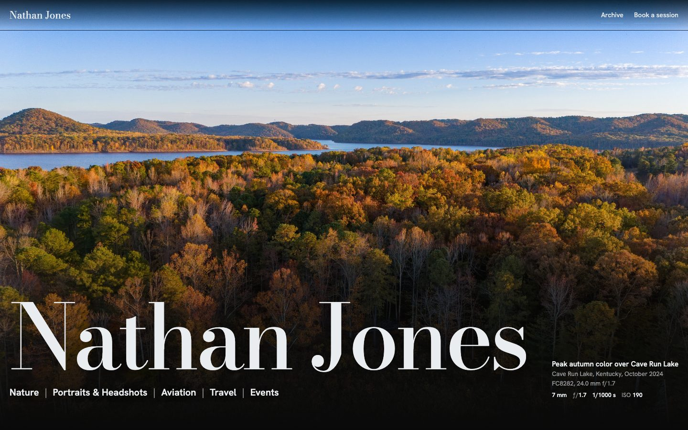
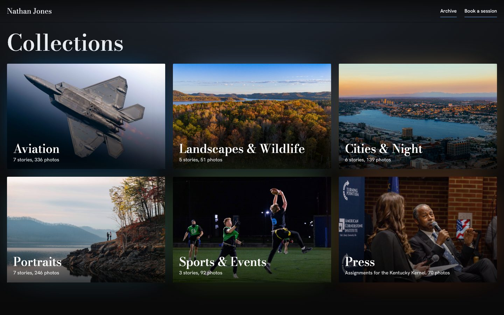
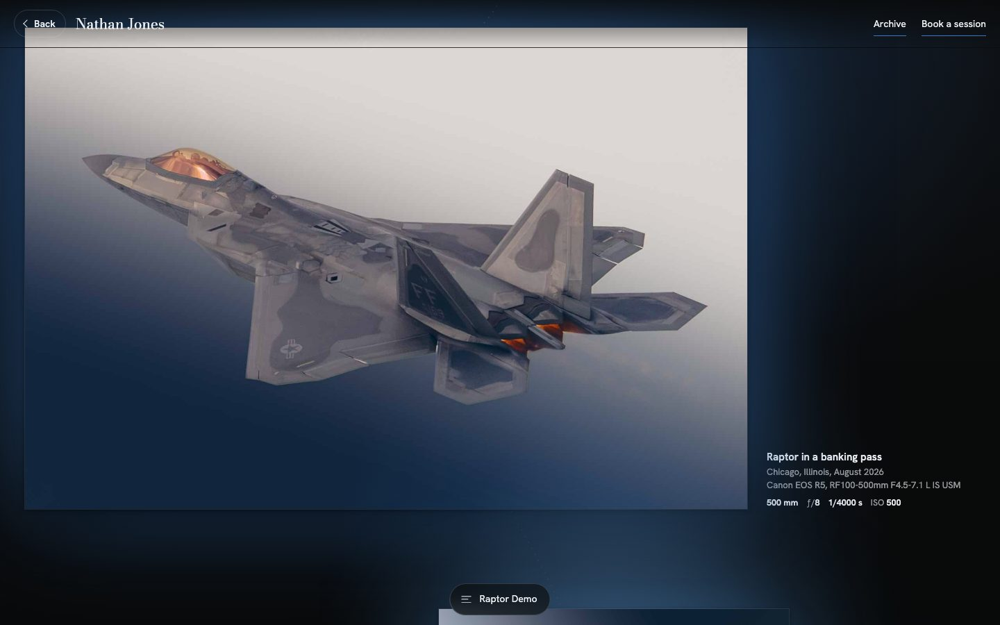
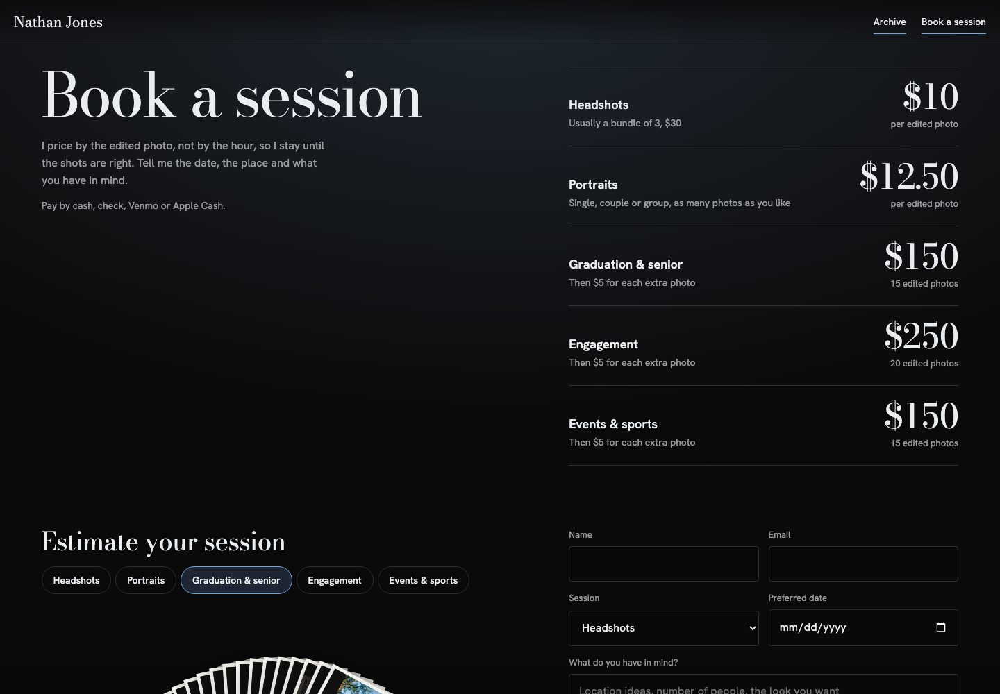
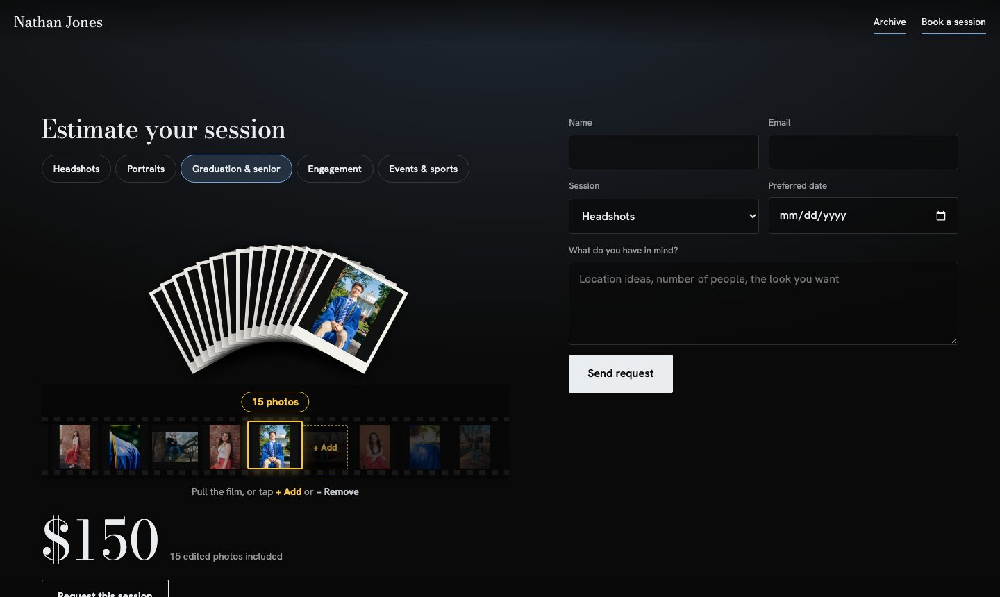
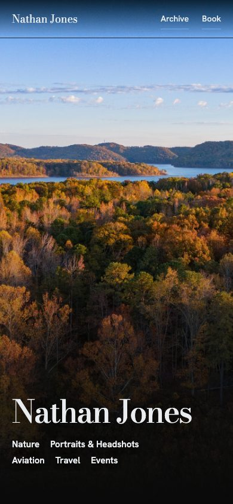
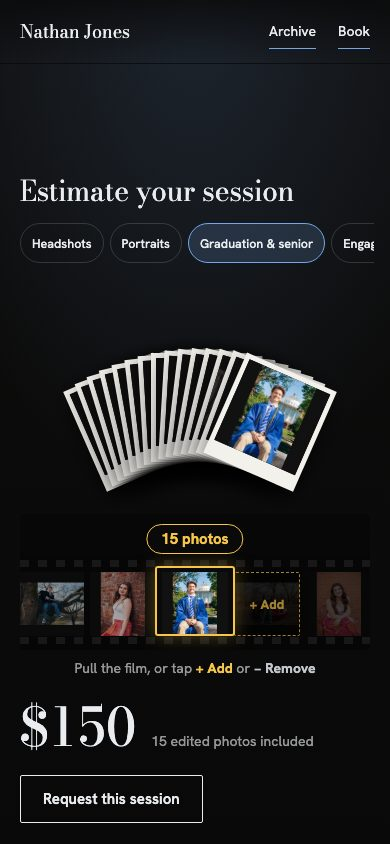

# Nathan Jones Photography

The new portfolio for [nathanjonesphoto.co](https://nathanjonesphoto.co): aviation, landscapes, portraits, cities and events from Kentucky and beyond, shown as a dark gallery you walk through, with a simple way to book a session.



## What's on the site

### Collections

The home page opens on a full-screen photo, then lays out six collections. Each collection is its own page.



### Stories

Every shoot is a story. It opens on a full-screen cover with its place and a line in Nathan's own words. The page takes on the colors of the photo you're looking at.


The photos hang on a lit wall with museum-style labels: title, place, camera, lens and settings. Vertical photos are never cropped. Tap any photo to see it full screen. Each collection ends with an archive of every photo from its shoots, filtered by shoot.



### Book a session

Prices are per edited photo, not per hour. The rate card animates in when you reach it.



The estimator shows your session as a hand of real prints from that kind of shoot. Pull the film strip, or tap **+ Add** or **− Remove**. Each new print drops onto the pile with a yellow glow and a small shake, and the total updates as you go. **Request this session** fills in the booking form.



### On a phone

Everything works at phone width: the menu stays on screen, Back returns you to where you were, and the estimator is easy to use with one thumb.

<p>
  
  &nbsp;
  
</p>

## How it's built

| Path | What it is |
|---|---|
| `site/gallery.html` | The site: one page with the home, collection, story, archive and booking views |
| `site/shared/` | Shared styles, the full-screen photo viewer and the ambient color that follows each photo |
| `site/portfolio.js` | Photo data: albums, titles, camera settings, colors and stories (generated) |
| `site/est/` | Photo sheets for the booking estimator |
| `content/picks.json` | Which photos are story photos, covers and archive photos, per shoot |
| `content/titles.json` | Every photo's title |
| `scripts/build_site_set.py` | Builds `site/portfolio.js` and the image files from the Portfolio folder |
| `scripts/preview_server.py` | Serves `site/` locally |

The source photos live in `~/Pictures/Lightroom Saved Photos/Portfolio`, one folder per shoot. The generated images (`site/p`, `site/k`, `site/t`) aren't committed; rebuild them:

```bash
python3 scripts/build_site_set.py
```

Then preview the site at http://localhost:8765/gallery.html:

```bash
python3 scripts/preview_server.py 8765
```

Story covers are built at 3200px and other story photos at 2400px, so they stay sharp on high-resolution screens.

## What's next

- Hosting on AWS, with each photo served at several sizes for phones and large screens
- Sending booking requests (the form is a preview for now)
